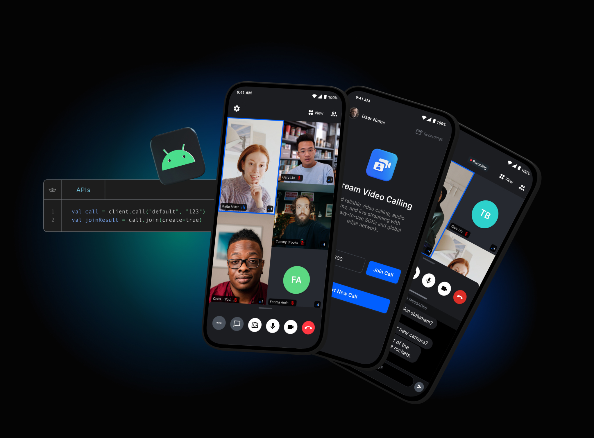

# Official Android SDK for [Stream Video](https://getstream.io/video/docs/)



<p align="center">
  <a href="https://github.com/GetStream/stream-video-android/actions/workflows/android.yml"></a>
  
  <a href="https://github.com/GetStream/stream-video-android/releases"></a>
</p>

<p align="center">
  <a href="https://deepwiki.com/GetStream/stream-video-android"></a>
</p>

<div align="center">


</div>

This is the official Android SDK for [Stream Video](https://getstream.io/video?utm_source=Github&utm_medium=Github_Repo_Content_Ad&utm_content=Developer&utm_campaign=Github_Android_Video_SDK&utm_term=DevRelOss), a service for building video calls, audio rooms, and live-streaming applications. This library includes both a low-level video SDK and a set of reusable UI components.
Most users start with the Compose UI components and fall back to the lower-level API when they want to customize things.

<a href="https://getstream.io?utm_source=Github&utm_medium=Github_Repo_Content_Ad&utm_content=Developer&utm_campaign=Github_Android_Video_SDK&utm_term=DevRelOss">

</a>

## 🛥 What is Stream?

Stream allows developers to rapidly deploy scalable feeds, chat messaging and video with an industry leading 99.999% uptime SLA guarantee.

Stream provides UI components and state handling that make it easy to build video calling for your app. All calls run on Stream's network of edge servers around the world, ensuring optimal latency and reliability.

## 🛠️ Installation

Releases are published to the [Stream Maven repository](https://browse.stream-io-repo.com/releases/stream-video-android). Add it to your `settings.gradle.kts`:

```kotlin
dependencyResolutionManagement {
    repositories {
        google()
        mavenCentral()
        maven("https://stream-io-repo.com")
    }
}
```

Earlier versions remain available from Maven Central.

## 📕 Tutorials

With Stream's video components, you can use their SDK to build in-app video calling, audio rooms, audio calls, or live streaming. The best place to get started is with their tutorials:

- **[Video & Audio Calling Tutorial](https://getstream.io/video/docs/android/tutorials/video-calling?utm_source=Github&utm_medium=Github_Repo_Content_Ad&utm_content=Developer&utm_campaign=Github_Android_Video_SDK&utm_term=DevRelOss)**
- **[Audio Rooms Tutorial](https://getstream.io/video/docs/android/tutorials/audio-room?utm_source=Github&utm_medium=Github_Repo_Content_Ad&utm_content=Developer&utm_campaign=Github_Android_Video_SDK&utm_term=DevRelOss)**
- **[Livestreaming Tutorial](https://getstream.io/video/docs/android/tutorials/livestream?utm_source=Github&utm_medium=Github_Repo_Content_Ad&utm_content=Developer&utm_campaign=Github_Android_Video_SDK&utm_term=DevRelOss)**

If you're interested in customizing the UI components for the Video SDK, check out the **[UI Cookbook](https://getstream.io/video/docs/android/ui-cookbook/overview?utm_source=Github&utm_medium=Github_Repo_Content_Ad&utm_content=Developer&utm_campaign=Github_Android_Video_SDK&utm_term=DevRelOss)**.

## 📱 Previews

<p align="center">


</p>

## 👔 Sample Projects

You can find sample projects below that demonstrates use cases of Stream Video SDK for Android:

- [Demo App](https://github.com/GetStream/stream-video-android/tree/develop/demo-app): Demo App demonstrates Stream Video SDK for Android with modern Android tech stacks, such as Compose, Hilt, and Coroutines.
- [Android Video Samples](https://github.com/GetStream/Android-Video-Samples): Provides a collection of samples that utilize modern Android tech stacks and Stream Video SDK for Kotlin and Compose.
- [WhatsApp Clone Compose](https://github.com/getstream/whatsapp-clone-compose): WhatsApp clone project demonstrates modern Android development built with Jetpack Compose and Stream Chat/Video SDK for Compose.
- [Twitch Clone Compose](https://github.com/GetStream/twitch-clone-compose): Twitch clone project demonstrates modern Android development built with Jetpack Compose and Stream Chat/Video SDK for Compose.
- [Meeting Room Compose](https://github.com/GetStream/meeting-room-compose): A real-time meeting room app built with Jetpack Compose to demonstrate video communications.
- [Audio Only Demo](https://github.com/GetStream/audio-call-sample-android): A sample implementation of an audio-only caller application with Android Video SDK. 

## 👩‍💻 Free for Makers 👨‍💻

Stream is free for most side and hobby projects. To qualify, your project/company needs to have < 5 team members and < $10k in monthly revenue. Makers get $100 in monthly credit for video for free.
For more details, check out the [Maker Account](https://getstream.io/maker-account?utm_source=Github&utm_medium=Github_Repo_Content_Ad&utm_content=Developer&utm_campaign=Github_Android_Video_SDK&utm_term=DevRelOss).

## 💡Supported Features💡

Here are some of the features we support:

* Developer experience: Great SDKs, docs, tutorials and support so you can build quickly
* Edge network: Servers around the world ensure optimal latency and reliability
* Chat: Stored chat, reactions, threads, typing indicators, URL previews etc
* Security & Privacy: Based in USA and EU, Soc2 certified, GDPR compliant
* Dynascale: Automatically switch resolutions, fps, bitrate, codecs and paginate video on large calls
* Screensharing
* Picture in picture support
* Active speaker
* Custom events
* Geofencing
* Notifications and ringing calls
* Opus DTX & Red for reliable audio
* Webhooks & SQS
* Backstage mode
* Flexible permissions system
* Joining calls by ID, link or invite
* Enabling and disabling audio and video when in calls
* Flipping, Enabling and disabling camera in calls
* Enabling and disabling speakerphone in calls
* Push notification providers support
* Call recording
* Broadcasting to HLS

## License

```
Copyright (c) 2014-2026 Stream.io Inc. All rights reserved.

Licensed under the Stream License;
you may not use this file except in compliance with the License.
You may obtain a copy of the License at

   https://github.com/GetStream/stream-video-android/blob/main/LICENSE

Unless required by applicable law or agreed to in writing, software
distributed under the License is distributed on an "AS IS" BASIS,
WITHOUT WARRANTIES OR CONDITIONS OF ANY KIND, either express or implied.
See the License for the specific language governing permissions and
limitations under the License.
```
